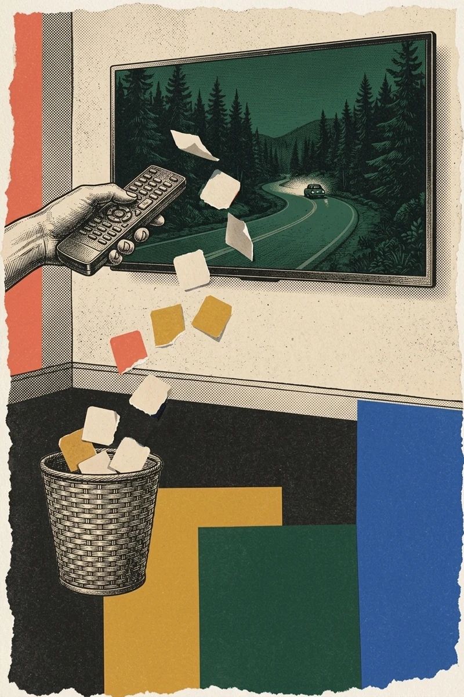
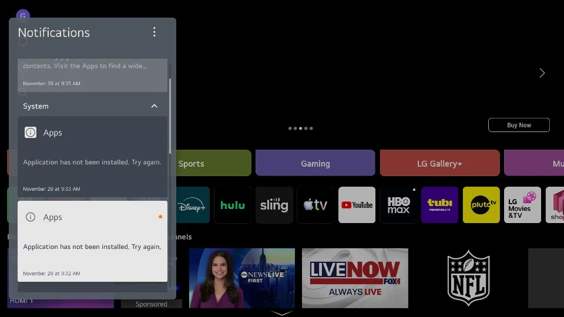
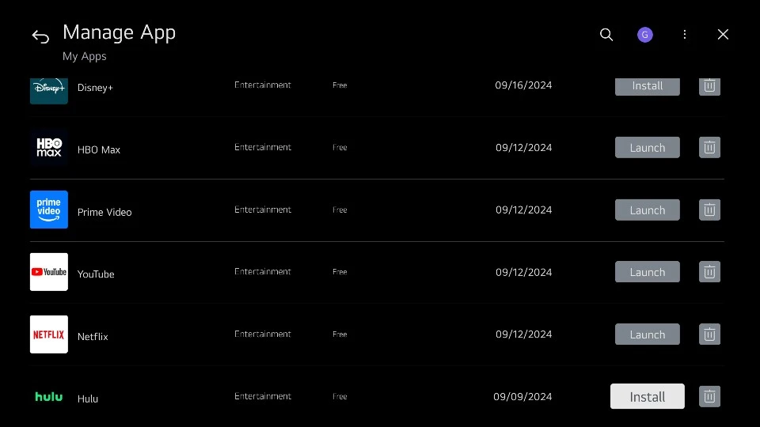
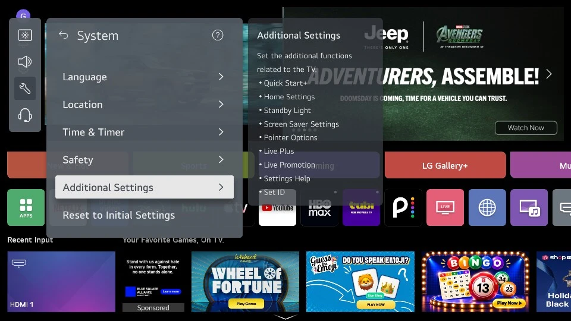
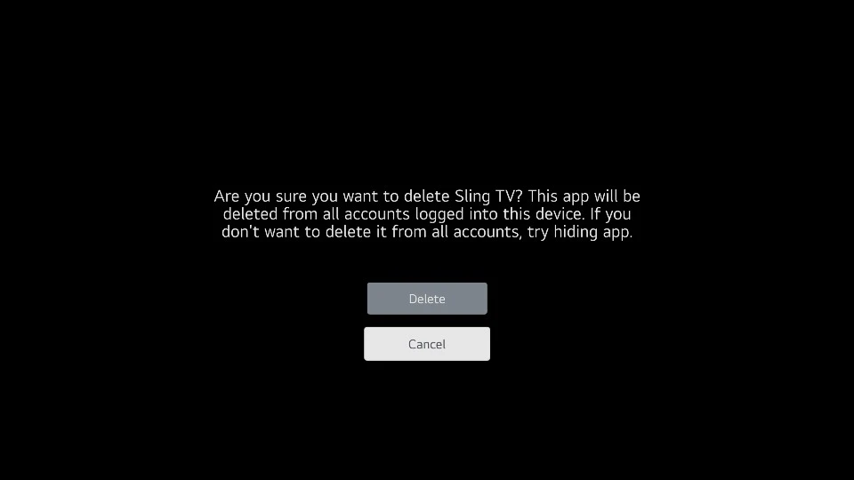
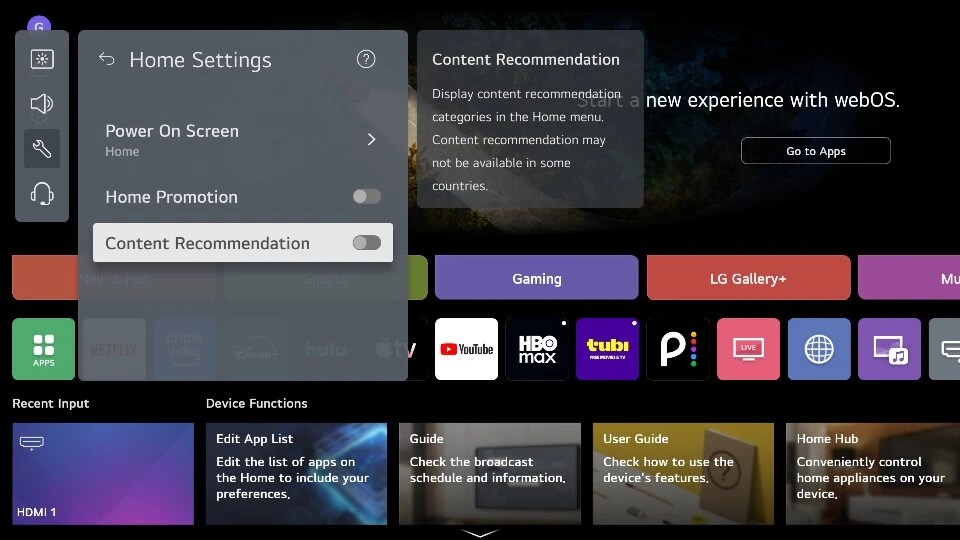
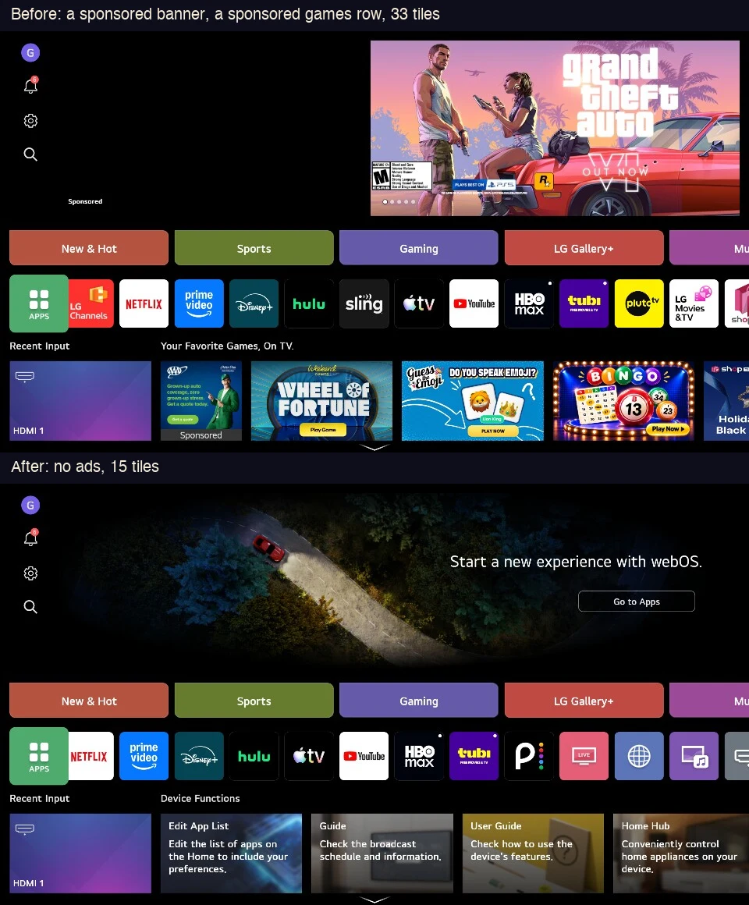

# I Let Claude Hold the *Remote.*

**Applied AI No. 02 · November 2026 · 7 min read**

*Why my TV stopped installing apps, and how an AI cleared 17 preloaded apps and the home-screen ads off it, one screenshot at a time. No hacking.*

---

You paid for your TV. It shows you ads anyway.

Ours opened on a Grand Theft Auto banner. Under it, a sponsored row of games. Then 33 tiles, most of which nobody in our house ever picked. And one morning, apps just stopped installing.

So I handed Claude the remote. Not the plastic one. The one the TV listens to over Wi-Fi.

By the end of this post you'll know how to have an AI look at a device in your house without breaking it, the five rules I'd make any AI follow before it touches one, and the menu paths if you'd rather just do it yourself tonight.

> The short version
>
> **1.** Tell it *which* device. Then tell it again.
>
> **2.** Let it look before it touches.
>
> **3.** A screenshot before every press.
>
> **4.** It asks before it deletes anything anyone uses.

---

Here's how it started. I'd cloned [CleanYourTV](https://github.com/Gathin23/cleanyourtv), an open-source project that strips ads and bloat off Android TVs (518 models and counting), and opened Claude Code in it:

> "I have a TV I kinda wanna run this on, but mostly I wanna diagnose what's wrong and why apps won't install on it."

Plot twist: our TV isn't Android. It's an LG, which runs LG's own system, webOS. The project's own notes say it can't touch these. No back door, nothing to install.

So Claude didn't use one. It used the connection LG built for remote-control apps, the same one [Home Assistant](https://www.home-assistant.io/integrations/webostv/) uses to control LG TVs. It pressed a button, took a screenshot, read it, and decided on the next press. Over and over.

**What you need:** a laptop on the same Wi-Fi, Claude Code (or another coding agent), the TV remote to say "Allow" once, and some patience. You won't write code. Claude writes the little script that talks to the TV.

## How it *works.*

One loop, and two moments where you're in charge.

<!-- SITE: inline SVG diagram. You → Claude (on your laptop) → presses one key → TV → screenshot back → Claude reads it. You approve the pairing once on the TV, and every delete. -->

## 1 · Tell it *which TV.*

We have two TVs. I said so, and said not to touch the other one.

Claude misread which one was "the other" and poked at the wrong TV. Read-only, no harm done. But that's exactly the kind of mistake that matters when the next step deletes things.

Since then, rule one: before anything changes, the AI names the device it's about to touch, by model, and waits for a yes.

> Name the device. *Then* touch it.

## 2 · Let it look *before it touches.*

The first stretch was all looking. What's on the network. What the TV says about itself. Which apps are installed. How much storage is free.

Then the notification bell. Seven identical messages from the app store:

*"Application has not been installed. Try again."*

All seven landed between 9:22 and 9:33 that morning. The TV had turned on at 9:16.

So Claude tried one install itself. It worked in under a minute. So did the one I actually wanted. Every failure happened in the first 17 minutes after power-on. Everything after that went through.

The bigger surprise was the home screen. Hulu, Disney+, Peacock, Sling: 13 of the 20 apps I was allowed to delete weren't really apps. They were placeholders, tiny stubs with version numbers like 0.0.32 that download the real thing the first time you open one. If that download fails, you get the message above.

Nothing was broken. I'd have spent an evening resetting things for nothing.

## 3 · It used *the remote.*

Driving a TV this way is slow and a little absurd. Press Right. Screenshot. Read. Press Right again.

It also taught us things a person never notices. Once, Claude sent two dozen right-presses in a row. The TV ignored every one. Too fast. The fix: wait two seconds after connecting, and a full second between presses. It typed into search boxes too, which beats spelling "YouTube TV" with arrow keys.

Is that efficient? No. Is it the same thing I'd do on the couch, minus the couch? Yes. Which is the point.

> It's not hacking if it's *the remote.*

## 4 · A screenshot before *every press.*

Here's what you don't see when you click through TV menus half-asleep: the dangerous buttons sit right next to the useful ones.

On this TV, *Reset to Initial Settings* is one row below the menu we needed. In the account screen, *Sign Out* sits directly under *Account Management*, and *Terminate My Account* lives in the same list.

So Claude never pressed OK blind. Move, screenshot, check what's highlighted, then press.

Deleting works the same way. The TV asks *"Are you sure you want to delete Sling TV?"* and Claude read the app's name in that sentence before choosing Delete. Eleven times, eleven names.

> Read the dialog. *Then* press OK.

## 5 · What *came off.*

My instructions were precise, in their way:

> "Debloat it, delete a bunch of stuff I don't use and is default there plz. CLEAN it up. No crazy DNS or network stuff tho."

"Stuff I don't use" is a judgment call, so Claude found a fair test: my LG account keeps a history of every app I've ever chosen. Anything on the TV that wasn't in that history came preloaded. Those 11 got deleted: Sling TV, Pluto TV, ShopTime, a pool game, a game-show app, Copilot and five of LG's own apps. Anything I'd chosen before stayed, even the placeholders.

Six built-ins can't be deleted, only hidden: LG Channels, Sports, Home Hub, LG Gallery+, Alexa, and Camera. Hidden. One menu brings them back.

Then the ads, which are just settings LG ships switched on:

Home Promotion off: the sponsored banner went away. Content Recommendation off: the sponsored row went with it. Screen Saver Promotion and Smart Tips off too. On the LG account, it unchecked marketing emails and the voice-print agreement and left the payment terms alone.

Live Plus was already off. That's LG's name for the feature that recognizes what's on your screen. A [2024 study of LG and Samsung TVs](https://arxiv.org/abs/2409.06203) found it running on live TV and on whatever you plug in over HDMI, and found that opting out stopped the traffic. Worth checking yours.

33 tiles became 15. Free app storage went from 468 MB to about 560 MB. And the first thing the TV shows now is a quiet picture of a road instead of a game trailer.

> Rather do it yourself? On a 2025 LG (webOS 25)
>
> **Ads on Home:** Settings → General → System → Additional Settings → Home Settings → turn off *Home Promotion* and *Content Recommendation*.
>
> **Screensaver ads:** same Additional Settings → Screen Saver Settings → *Screen Saver Promotion* off.
>
> **Screen tracking:** same Additional Settings → *Live Plus* off.
>
> **Pop-up tips:** General → AI Service → AI Recommendation → *Smart Tips* off.
>
> **Apps:** scroll to the end of the app row → *Edit App List* → the trash icon deletes, the eye icon hides.
>
> *Menus move between years. These are from one 2025 set.*

## 6 · Make it *teach you.*

The cleanup is nice. What I learned is the part that sticks.

I now know why a tile can say Hulu and not be Hulu. I know where my TV's ads actually come from: two switches, not some unknowable ad empire. I know which built-ins LG won't let me delete, and that a firmware update can quietly flip things back.

I also know what Claude couldn't do. It looked for LG's ad-tracking page in the settings and the account menus and didn't find it on this model. It said so instead of guessing. I'll take that over a confident wrong answer every time.

Here's what coaching sounds like when the AI is holding the remote:

- *"Before you press OK, tell me what's highlighted and what's one row above and below it."*
- *"Which of these changes can't be undone?"*
- *"What did you find that you didn't expect?"*
- *"Draw me how you're talking to the TV."* (That's the diagram at the top of this post.)
- *"Make me a list of everything you changed, and how to put each one back."*

## Not an LG? *Same idea.*

| Your TV | Start here |
| --- | --- |
| **Android TV or Google TV** (Sony, TCL, Hisense, Xiaomi, most streaming boxes) | [CleanYourTV](https://github.com/Gathin23/cleanyourtv): paste its prompt into Claude Code. It can switch off far more than the menus can, and every change has a one-line undo. |
| **Samsung, Roku, Vizio, Hisense VIDAA** | [cleanyour.tv/not-android](https://cleanyour.tv/not-android): the privacy switches, step by step, with the remote. |
| **LG** | This post. The box at the bottom does the setup. |

## Start small. *Seriously.*

**Level 1 · Tonight, about 15 minutes, no AI.** Grab the remote and follow the "Rather do it yourself?" box above. The two Home Settings switches alone take the ads off your home screen.

**Level 2 · When something's off.** Open Claude Code on a laptop on the same Wi-Fi and say: *"Find my TV on the network and tell me what's wrong with it. Don't change anything. Ask me before you connect to anything."* Diagnosis only. That's where my mystery was solved.

**Level 3 · When you want it clean.** Paste the box at the bottom of this post into Claude Code. It brings the rules with it: name the device, screenshot every press, ask before deleting, and keep a list of how to undo everything.

> The remote rule
>
> **Name** the device.
>
> **Look** before you touch.
>
> **Screenshot** every press.
>
> **Ask** before you delete.
>
> **Keep** a way back.
>
> *The AI holds the remote. You keep the final say.*

#### Your move

- **Tonight:** Level 1. Two switches, and the ads are gone.
- **Got a weird device problem?** Try Level 2 and let it look first.
- **Cleaned something up?** Send me your before and after. I want to see it.

[Start a conversation →](mailto:harsh@harshrana.com)

Coming next in Applied AI: what it takes to send this back to the open-source project that started it.

Until next time,

Harsh

**Sources:** [CleanYourTV](https://github.com/Gathin23/cleanyourtv) · [cleanyour.tv/not-android](https://cleanyour.tv/not-android) · [Anselmi et al., "Watching TV with the Second-Party", IMC 2024](https://arxiv.org/abs/2409.06203) · [Home Assistant's LG webOS integration](https://www.home-assistant.io/integrations/webostv/)

---

## For your AI: *clean up my LG TV*

You don't need to read this part. It's written for Claude Code (or whatever coding agent you use).

Open Claude Code on a computer on the same Wi-Fi as your TV, and paste everything in [ai-holds-the-remote-setup.md](/musings/ai-holds-the-remote-setup.md). It will find the TV, ask before every step that matters, and keep a list of how to undo everything.
