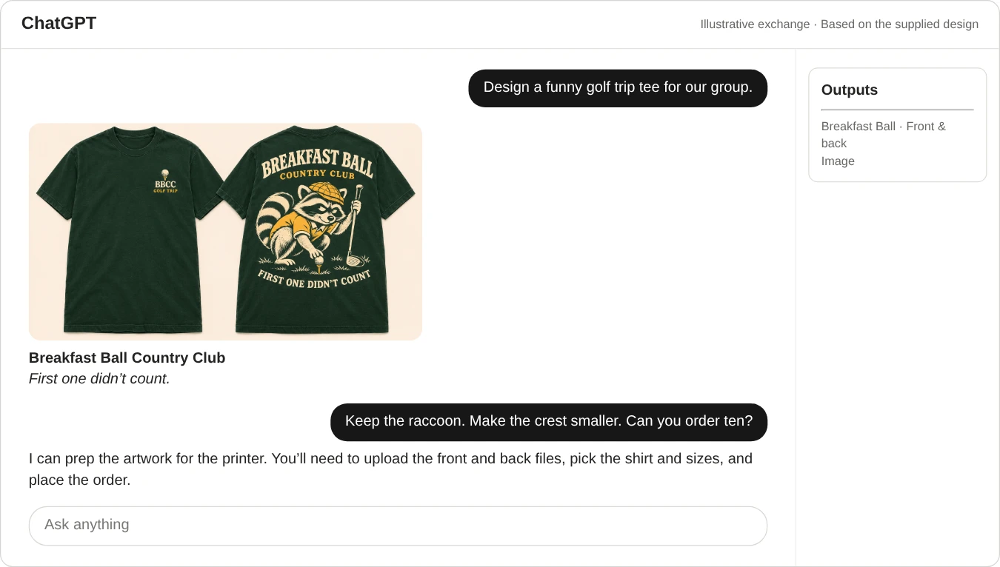
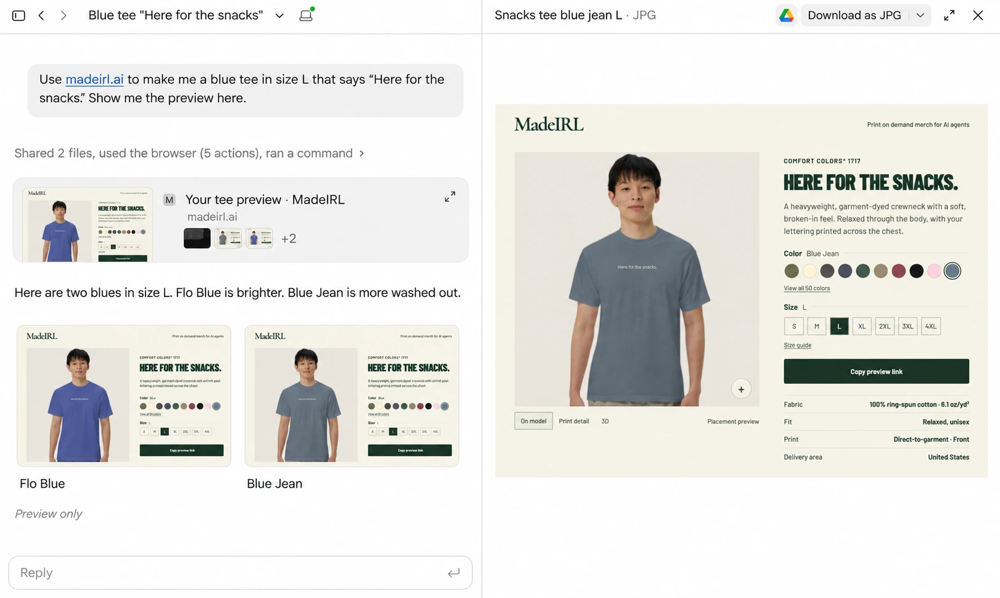

# ChatGPT, I’ll take ten

Suggest matching shirts for a golf trip and you’ll get nine enthusiastic replies. Congratulations. You’re now the shirt guy.

I gave ChatGPT the fun part of the job: design a funny tee for the trip. It came back with **Breakfast Ball Country Club**. Washed green shirt, little crest on the chest, a raccoon on the back teeing up another ball. Underneath him, in cream lettering: *First one didn’t count.*

I’d wear that. More importantly, I know exactly which of my friends would insist on explaining the joke to strangers.

*ChatGPT design example. The follow-up exchange is illustrative.*

You can spend another minute riffing. Try “Provisional Ball Club.” Make the crest smaller. Keep the raccoon. Actually, the first line was better.

Then comes the easiest sentence in the whole conversation: **“Perfect. I’ll take ten.”**

This is usually where my agent gives me homework. Download the image. Pick a printer. Find a green tee that looks like the green tee everybody just agreed on. Upload the front and back. Dig through the group chat for sizes. Somewhere in there, figure out whether the box will beat us to the rental house.

That handoff is why I’m building [MadeIRL](https://madeirl.ai). I want to order the shirt in the conversation where we designed it.

## Couldn’t the agent just use a browser?

Yes. One of the best moments I’ve had building this came from watching it do exactly that.

But first, consider what a browser agent inherits when you send it to a print shop. Custom Ink’s Design Lab has controls for picking a product, uploading artwork, adding and resizing text, and switching between the front and back. Its pricing guide describes saving the design and entering quantities to get a quote. If you’ve ever made a group shirt, you can probably picture the screen. [Custom Ink’s Design Lab guide](https://www.customink.com/help_center/navigate-the-lab) · [How quoting works](https://www.customink.com/ndx/)

Now give the agent our raccoon picture and tell it to make the crest smaller. The picture shows two finished shirts side by side. The printer needs the art that goes on each one. Even if the agent finds the text-size control on its first click, the lettering in that image is pixels. And if a save form asks for an email, the agent has a judgment call to make. I asked it to try a smaller crest. Did I mean for it to give a shop my contact details?

Those are all solvable problems. What interests me is how many of them the customer should ever have to hear about.

## I asked for blue. Claude brought back two shirts.

For a real test, I gave Claude a less ambitious brief: use MadeIRL to make me a blue tee in size L that says “Here for the snacks.” Show it to me on a model, right here in the chat.

The catalog had *Flo Blue* and *Blue Jean*. One was the bright blue you might picture when somebody says “blue shirt.” The other was washed out enough to look almost gray. Claude used MadeIRL in the browser, made both previews, and brought them back into the conversation.

*Real MadeIRL preview session in Claude. This editorial recreation shortens the exchange and replaces the development URL. No order was placed.*

That little choice is the experience I want. I didn’t have to learn the supplier’s name for blue. Claude didn’t have to guess which one I meant. I could look at the shirts and say, “The washed-out one.”

Now imagine the next message: **“Ten of those. Can they get here by Thursday?”**

A useful answer takes some work. MadeIRL has to check whether the printer has the sizes we need, generate a proof from the artwork that will actually be printed, and quote a delivered price for the address we’ll be at on Thursday. I want to see that proof, the total, and the delivery estimate together. *That’s* the moment to ask for my approval.

After I approve, a payment retry shouldn’t turn ten shirts into twenty. If the last XL sells out, I want the agent to bring me a choice before somebody quietly orders Dave a medium. When the box ships, the tracking should land in the same conversation. That’s where I’ll go looking for it anyway.

This is my bet on the agent economy. Nobody on the golf trip was shopping for a print vendor. We had a joke, ten people who’d wear it, and roughly zero volunteers to organize it. A business that an agent can bring into that moment has a shot at an order that otherwise dies at “we should make shirts.”

[You can see what I’m building at MadeIRL.](https://madeirl.ai) The preview works today. My first test for the rest is personal: I want to order ten shirts for my golf trip without ever leaving Claude. I’ll call it working when the first thing I have to open is the box.

Put me down for a medium. And a five.
